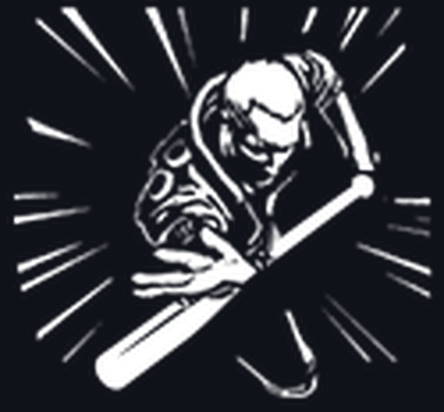

# Blunt Leap (vanilla-style progression)

A Cyberpunk 2077 mod that lets V do the leap attack with blunt weapons: fists, one-handed and two-handed blunt weapons, hammers, stun batons and Gorilla Arms.

The goal is a mod that feels like part of the game: two new perks in the Body tree, the same leap blades already have, and every number adjustable in Mod Settings.

## Status

Work in progress, built in three steps. **Step 1 is written and compiles; it has not been tested in game yet.**

| Step | Contents | State |
|---|---|---|
| 1 | Leap with every blunt weapon (always allowed), leap range, hammer timing, distance damage bonus, charge for blunt weapons with the native charge bar, "Always charged" mode, settings | written, compiles, untested in game |
| 2 | Stronger leap on a full charge: longer and faster leap, EMP on a crit, send the enemy flying or stagger them, full-charge feedback | not started |
| 3 | The two perks in the Body tree, unlock rules, automatic refunds, perk icons | not started |

The full design is in [SPEC.md](SPEC.md). The game facts behind it are in [RESEARCH.md](RESEARCH.md).

## Requirements

- Cyberpunk 2077, patch 2.x (compile-checked against the current patch)
- RED4ext, redscript, TweakXL
- Mod Settings (optional: without it the mod runs on its defaults)
- Later steps will also need Codeware and Perk Addition Framework

## Install (manual)

Copy the `r6` folder into the game folder. That adds two folders and changes no existing file:

- `r6/scripts/BluntLeap/`
- `r6/tweaks/BluntLeap/`

To remove the mod, delete those two folders.

## How it works

- The game decides a leap from one flag on the player, `CanMeleeLeap`. The blade perk grants it while a blade is held. This mod grants it while a blunt weapon is held, with the same kind of data package the perk uses.
- The scripts only wrap game functions and always call the original first. Nothing is replaced, no vanilla record is edited, and finisher leaps pass through untouched.
- Charging uses the game charge pool type, so the game fills it, draws its own bar and applies its own charged-damage rule.

## Layout

| Path | What |
|---|---|
| `r6/scripts/BluntLeap/` | redscript: settings, the system, the leap hooks, the charge hooks |
| `r6/tweaks/BluntLeap/` | TweakXL records: the leap ability, the distance bonus, the charge pool |
| `art/` | the perk icon (PNG at the game size, SVG, and a preview) |
| `tools/compile_check.sh` | compiles the scripts against a game install in a scratch folder |
| `tools/make_icon.py` | builds the icon from the game icon it is based on |

## Credits

- The perk icon is the Flash and Thunderclap perk icon of Cyberpunk 2077 by CD PROJEKT RED with its katana replaced by a baseball bat.
- This is an unofficial fan mod, not affiliated with or endorsed by CD PROJEKT RED.
