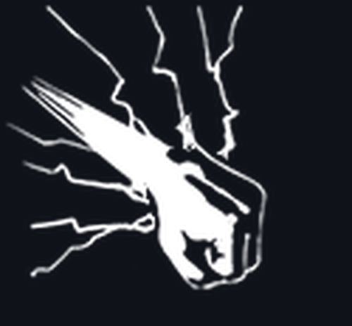

# Blunt Leap (vanilla-style progression)

A Cyberpunk 2077 mod that lets V do the leap attack with blunt weapons: fists, one-handed and two-handed blunt weapons, hammers, stun batons and Gorilla Arms.

The goal is a mod that feels like part of the game: two new perks in the Body tree, **Battering Ram** and **Thunder Breaker**, the same leap blades already have, and every number adjustable in Mod Settings.

 

## Status

Version 1.0.0. Played and tested in game (2026-11-22): the leap with blunt weapons, the charge, both perks and the Dash requirement, the stronger leap (throw, stagger, EMP), the perk screen, the perk texts and the perk-card videos. The test list is [TESTING.md](TESTING.md).

| Part | Contents |
|---|---|
| Battering Ram | Leap with every blunt weapon, leap range, hammer timing, distance damage bonus, a charge for blunt weapons with the game's own charge bar, "Always charged" mode |
| Thunder Breaker | Stronger leap on a full charge: longer and faster leap, EMP on a crit, send the enemy flying or stagger them, hit stop, full-charge sound, flash and rumble |
| Perks | Two perks in the Body tree with the game's look, icons, texts and videos; four unlock rules; the Dash requirement with a Dash box on the perk screen; automatic refunds |

Not confirmed in game yet: the setting "Charge speed under Sandevistan" (default Full) after its second build.

The full design is in [SPEC.md](SPEC.md). The game facts behind it are in [RESEARCH.md](RESEARCH.md).

## Requirements

- Cyberpunk 2077, patch 2.x (compile-checked against the current patch)
- RED4ext, redscript, TweakXL, Codeware
- Perk Addition Framework, for the two perks. Without it the mod grants the leap and the stronger leap without perks.
- Mod Settings (optional: without it the mod runs on its defaults)

## Install

With Vortex or Mod Organizer 2, install the zip from Nexus Mods. By hand, unzip it into the game folder (or copy the `r6` and `archive` folders from this repository). That adds two folders and one file, and changes no existing file:

- `r6/scripts/BluntLeap/`
- `r6/tweaks/BluntLeap/`
- `archive/pc/mod/BluntLeap.archive` (the two perk icons and the two perk-card videos)

To remove the mod: refund the two perks first (or switch the unlock rule to one without perks and load the save once), then delete those two folders and the archive.

## How it works

- The game decides a leap from one flag on the player, `CanMeleeLeap`. The blade perk grants it while a blade is held. This mod grants it while a blunt weapon is held, with the same kind of data package the perk uses.
- The scripts only wrap game functions and always call the original first. Nothing is replaced, no vanilla record is edited, and finisher leaps pass through untouched.
- Charging uses the game charge pool type, so the game fills it, draws its own bar and applies its own charged-damage rule.
- The two perks are real perks: Perk Addition Framework adds their IDs to the game, so buying, selling, respec and saving are the game's own. The one vanilla record touched is the Body page's perk list, which gets the two perks appended.
- The stronger leap's hit effects run from a small effector class named in a data record, at the stage where the crit is known and the enemy has not reacted yet. Sending an enemy flying uses the same two events as the Gorilla Arms knockout punch.

## Layout

| Path | What |
|---|---|
| `r6/scripts/BluntLeap/` | redscript: settings, the system, leap, charge, hit effects, perks, perk screen, texts |
| `r6/tweaks/BluntLeap/` | TweakXL records: the leap ability, the distance bonus, the charge pool, the hit effector, the EMP, the two perks |
| `TESTING.md` | the list for the first in-game test |
| `art/` | the two perk icons (PNG at the game size, previews; an SVG of the Blunt leap icon) |
| `art/video/` | the two perk-card videos (Bink, 700 x 394, 30 fps, from in-game recordings) |
| `archive/pc/mod/BluntLeap.archive` | the two perk icons and the two perk-card videos packed for the game |
| `tools/pack_icons.sh` | builds that archive from the two PNGs in `art/` and the two videos in `art/video/` |
| `tools/compile_check.sh` | compiles the scripts against a game install in a scratch folder |
| `tools/make_icon.py` | builds the Blunt leap icon from the game icon it is based on |
| `tools/make_stronger_icon.py` | builds the Stronger leap icon from the two game icons it is based on |
| `tools/make_videos.py` | cuts the in-game recordings and encodes them into the two perk-card videos |
| `tools/make_release.sh` | builds the zip for Nexus Mods (`dist/BluntLeap-<version>.zip`) from the last commit |
| `tools/render_perk_box.py` | renders a perk box (and its wires) at high resolution from the game's own UI textures and style values |

## Credits

- The perk icons are made from Cyberpunk 2077 perk icons by CD PROJEKT RED: Blunt leap is Flash and Thunderclap with its katana replaced by a baseball bat; Stronger leap is In Charge with its bullet replaced by the fist of Kinetic Absorption.
- This is an unofficial fan mod, not affiliated with or endorsed by CD PROJEKT RED.
